# Serverless Student Management API

## 1. Project Title

**Serverless Student Management API**

## 2. Project Overview

This project is a simple API for adding, viewing, updating, and deleting student records. AWS Lambda runs the code, Amazon API Gateway receives requests, and Amazon DynamoDB stores the records.

## 3. Assignment Objective

Build and test a serverless student management API using AWS Lambda, Amazon API Gateway, and Amazon DynamoDB.

## 4. AWS Services Used

- **AWS Lambda** – runs the API code.
- **Amazon API Gateway** – provides the API endpoints.
- **Amazon DynamoDB** – stores student records.
- **AWS IAM** – gives Lambda permission to access DynamoDB.

## 5. Architecture

The client sends a request to API Gateway. API Gateway invokes the `student-api` Lambda function. Lambda reads or changes records in the `Students` DynamoDB table and sends a response back through API Gateway.

## 6. Architecture Diagram

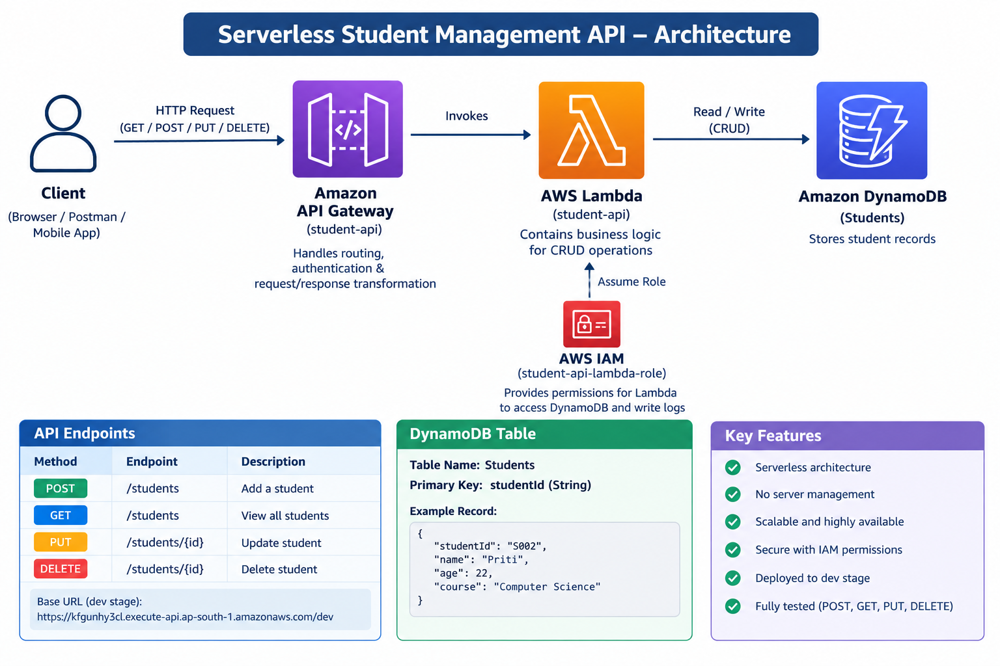

## 7. DynamoDB Configuration

- **Table:** `Students`
- **Partition key:** `studentId` (String)
- **Region:** `ap-south-1` (Asia Pacific - Mumbai)

The screenshot shows the table creation confirmation and its Active status.

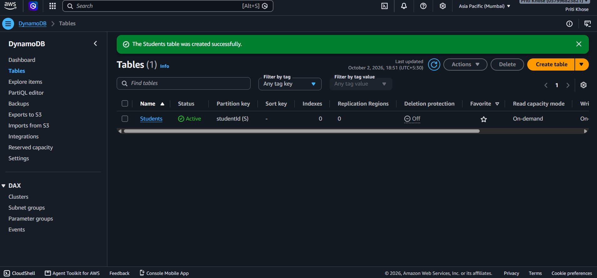

Example student record:

```json
{
  "studentId": "S001",
  "name": "Priti",
  "age": 22,
  "course": "Computer Science"
}
```

## 8. Lambda Function

- **Function name:** `student-api`
- **Purpose:** handles student API requests and accesses the DynamoDB table.

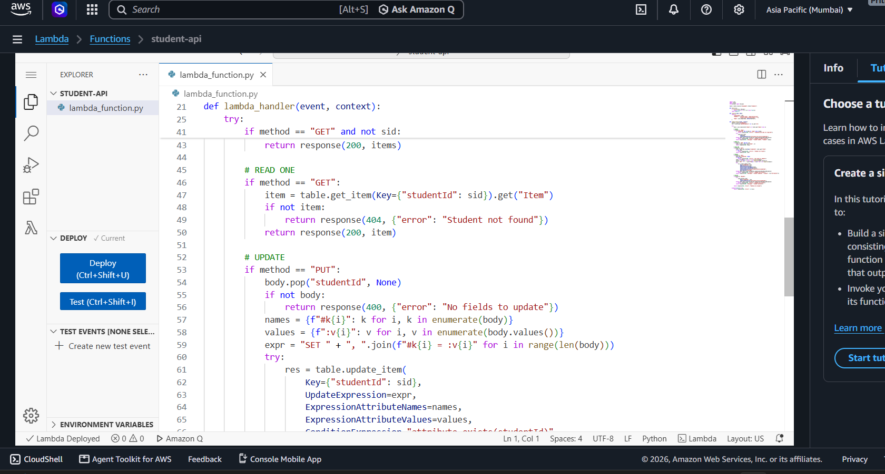

## 9. API Endpoints

The API Gateway API is named `student-api` and uses the `dev` stage.

| Method | Endpoint | Purpose |
|---|---|---|
| `POST` | `/students` | Add a student |
| `GET` | `/students` | View all students |
| `GET` | `/students/{id}` | View one student |
| `PUT` | `/students/{id}` | Update a student |
| `DELETE` | `/students/{id}` | Delete a student |

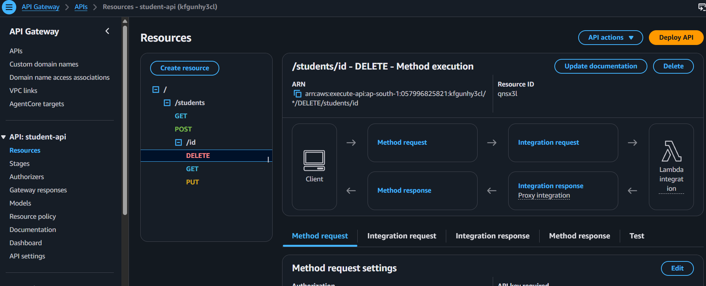

## 10. API Request and Response Examples

### Add a student

`POST /students`

Request:

```json
{
  "studentId": "S001",
  "name": "Priti",
  "age": 22,
  "course": "Computer Science"
}
```

Successful response (`201`):

```json
{
  "message": "Student added",
  "student": {
    "studentId": "S001",
    "name": "Priti",
    "age": 22,
    "course": "Computer Science"
  }
}
```

### View all students

`GET /students` returns the student records. The test returned status `200`.

### View one student

`GET /students/S001` returns the record whose `studentId` is `S001`.

### Update a student

`PUT /students/S001`

Request:

```json
{
  "name": "Priti Updated",
  "age": 23,
  "course": "AWS Cloud"
}
```

### Delete a student

`DELETE /students/S001` deletes that student record.

## 11. IAM Permissions

The Lambda function uses the IAM role `student-api-lambda-role`. Its permissions allow the function to work with the `Students` DynamoDB table.

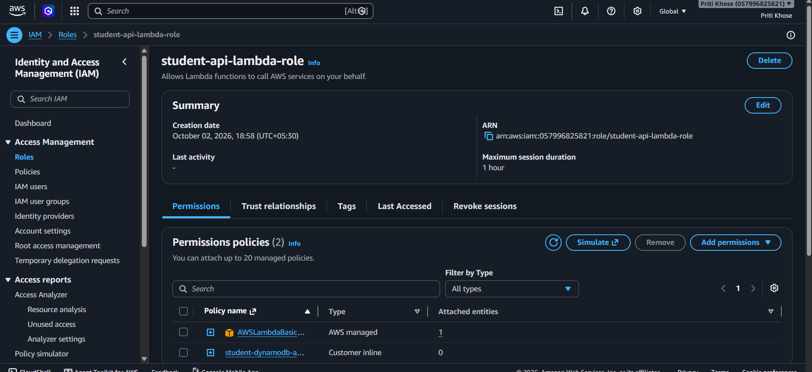

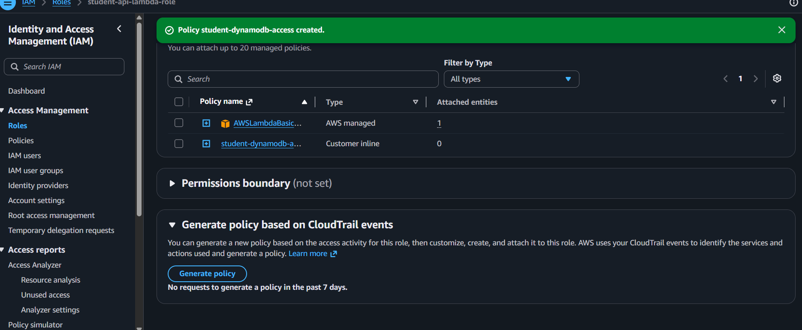

## 12. Testing and Results

The API was tested with sample student data. All four operations returned successful status codes.

| Test | Result |
|---|---|
| `POST /students` | `201` Successful |
| `GET /students` | `200` Successful |
| `PUT /students/{id}` | `200` Successful |
| `DELETE /students/{id}` | `200` Successful |

### POST: Add a student

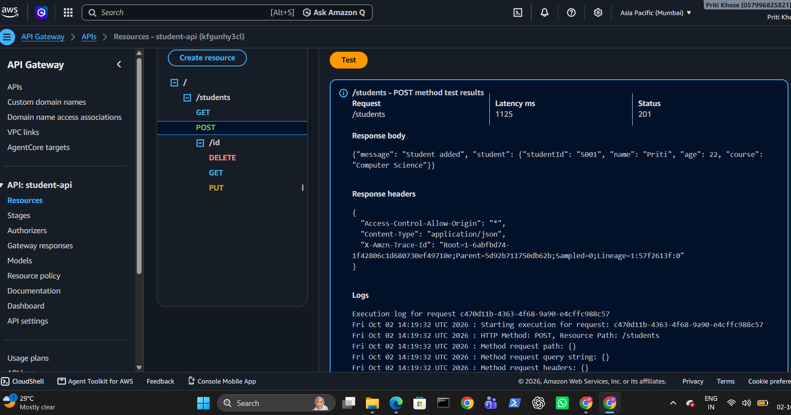

### GET: View all students

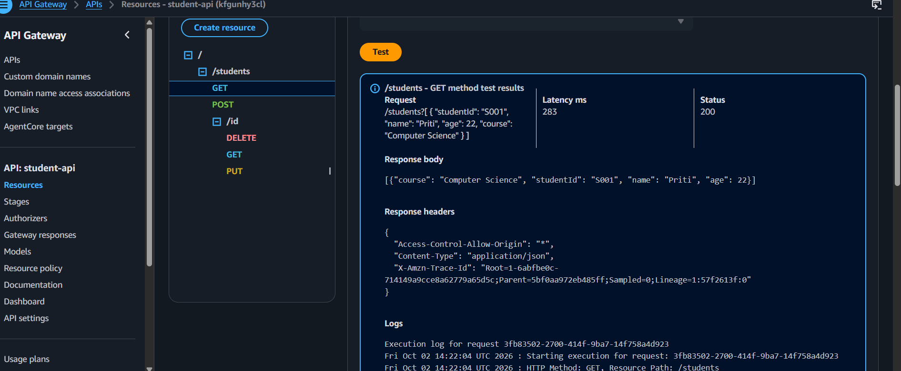

### GET: View one student

This endpoint is available. A separate GET-one test screenshot was not included.

### PUT: Update a student

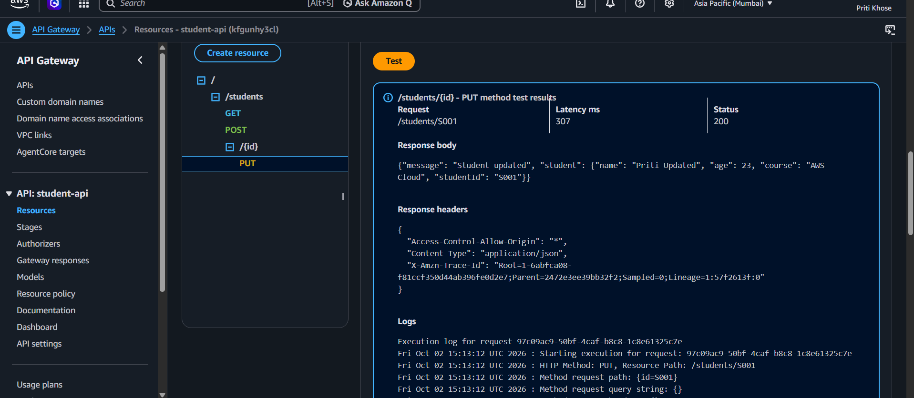

### DELETE: Delete a student

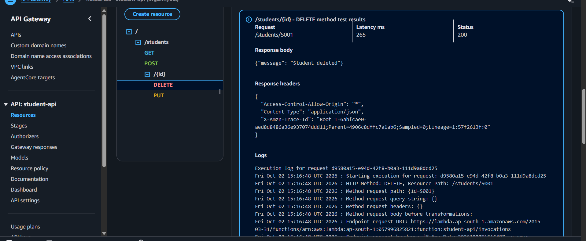

After the delete test, the table contained no student items.

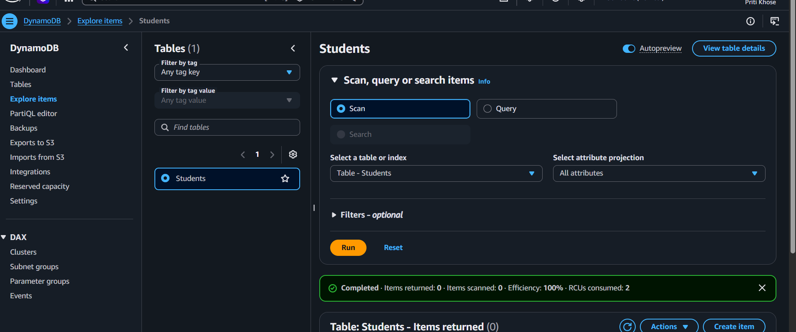

## 13. Deployment

The API is deployed in AWS region `ap-south-1`. The API Gateway stage is `dev`.

## 14. Live API URL

**Base URL:** [https://kfgunhy3cl.execute-api.ap-south-1.amazonaws.com/dev](https://kfgunhy3cl.execute-api.ap-south-1.amazonaws.com/dev)

**View students:** [https://kfgunhy3cl.execute-api.ap-south-1.amazonaws.com/dev/students](https://kfgunhy3cl.execute-api.ap-south-1.amazonaws.com/dev/students)

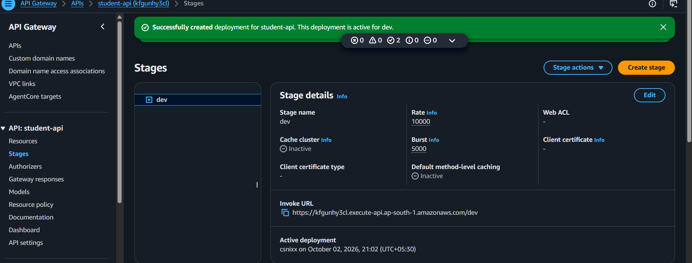

## 15. Project Structure

```text
Serverless Student Management API/
├── README.md
└── screenshots/
    ├── Serverless-Architecture.png
    ├── 02-dynamodb-table-active.png
    ├── 03-iam-policy-created.png
    ├── 04-iam-role-policies.png
    ├── 05-lambda-code-deployed.png
    ├── 06-api-gateway-resources.png
    ├── 06-api-gateway-stage.png
    ├── 07-test-post.png
    ├── 08-test-get-all.png
    ├── 10-test-put.png
    ├── 11-test-delete.png
    └── 12-dynamodb-items-after-delete.png
```

## 16. Conclusion

This assignment demonstrates how Lambda, API Gateway, DynamoDB, and IAM can work together to provide a serverless student management API.

**Author:** Priti Khose  
**Role:** AWS Cloud Fresher
